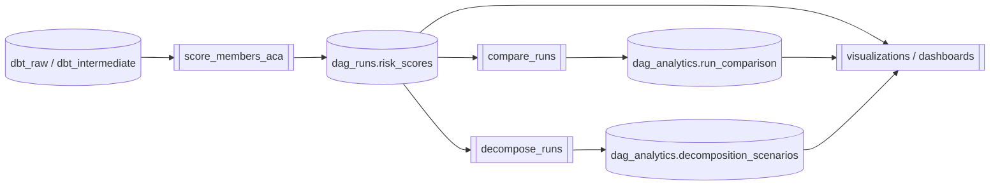
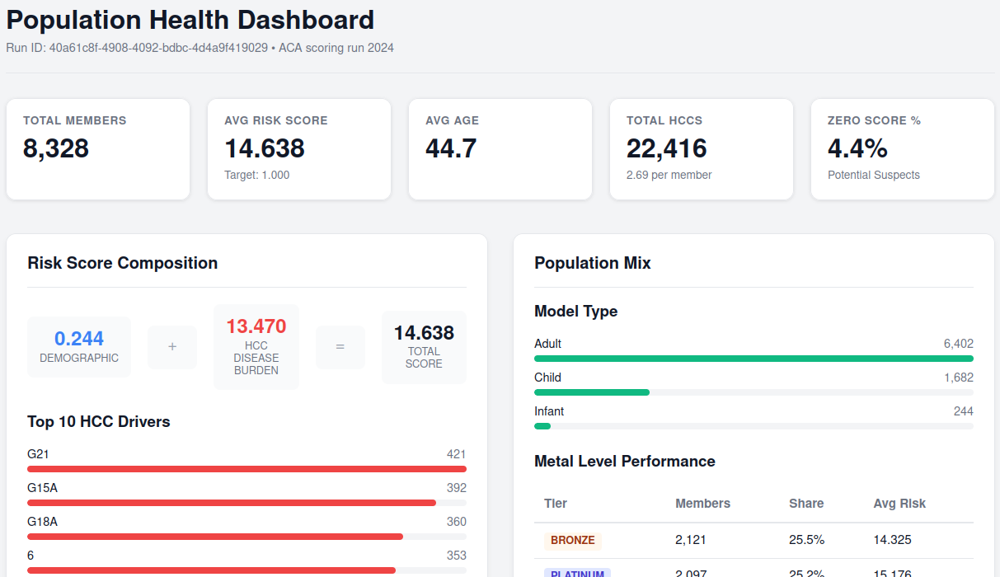
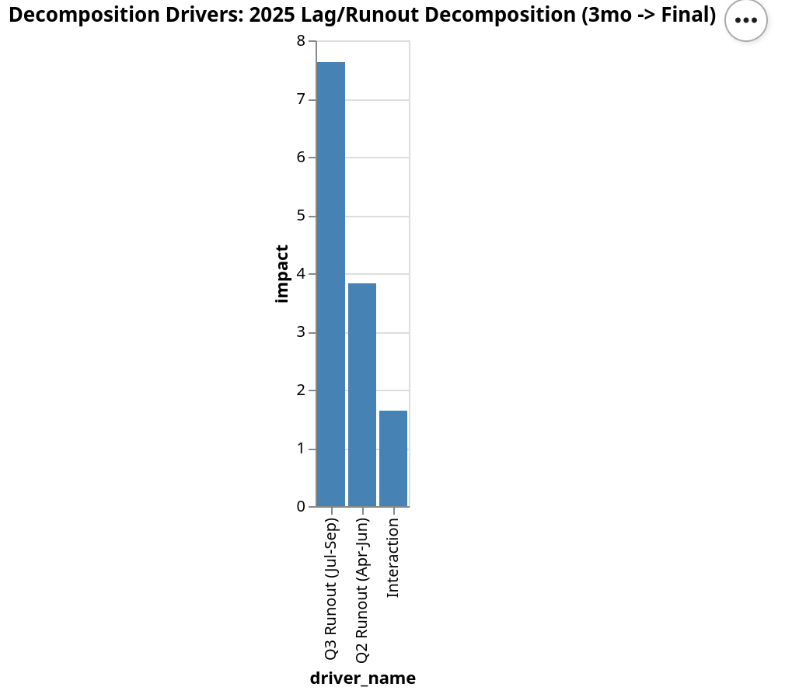

# Prism: Risk Adjustment Analytics Platform

```text
         ____   ____(_)_______   __ .................
        / __ \/ ___/ / ___/ __ \/__ \................
......./ /_/ / /  / (__  ) / / / / /.................
      / .___/_/  /_/____/_/ /_/ /_/..................
     /_/ Prism: Risk Adjustment Analytics Platform...
                -decompose the risk spectrum.........
```

**Prism is a proof-of-concept** that replaces opaque legacy risk adjustment tools with a transparent, code-first stack. Every risk score is reproducible, traceable to source claims, and diffable against any other run, so the question "why did risk scores (revenue) change?" has an answer.

*   **Glass box**: all logic is Python + SQL, version-controlled in Git.
*   **Reproducible**: every run gets a unique ID, a config snapshot, and git provenance.
*   **Explainable**: diff any two runs, then decompose the change into drivers such as "Population Mix" or "Model Change".
*   **Modern stack**: [dbt](https://www.getdbt.com/) for SQL transforms, [Dagster](https://dagster.io/) for orchestration, PostgreSQL for storage. Python and SQL rank among the most desired technologies in the [2024 Stack Overflow Developer Survey](https://survey.stackoverflow.co/2024/technology#admired-and-desired).

Scoring currently implements the ACA **HHS-HCC** model using the official CMS DIY tables for benefit years 2021-2025.

## Quick Start

```bash
# 1. Start PostgreSQL
podman-compose -f infrastructure/docker-compose.yml up -d

# 2. Create the Dagster schemas (dag_runs, dag_analytics)
uv run python -m ra_dagster

# 3. Load seed data and build dbt models
cd ra_dbt && uv run dbt seed --full-refresh && uv run dbt build && cd ..

# 4. Launch the Dagster UI at http://localhost:3000
make dagster
```

To wipe the database and rebuild it from scratch, run `make dbt-refresh`. It performs the same steps above with `down -v` first.

## Repository Layout

| Directory | Role |
|-----------|------|
| [`ra_dbt/`](ra_dbt/) | dbt project. Cleans raw claims, enrollment, and member seeds into `int_aca_risk_input`, the standardized scoring input. Data dictionary: https://garthmortensen.github.io/prism |
| [`ra_calculators/`](ra_calculators/) | Pure-Python HHS-HCC calculator. Isolated from orchestration so it is unit-testable. |
| [`ra_dagster/`](ra_dagster/) | Dagster assets and jobs: scoring, comparison, decomposition, dashboards. Maintains the `dag_runs.run_registry` audit trail. See the [module README](ra_dagster/README.md). |
| [`infrastructure/`](infrastructure/) | Compose file and Dockerfiles for the PostgreSQL warehouse. |
| [`docs/`](docs/) | Architecture decision records, requirements, and generated function maps. |

## System Architecture

Raw claims flow through three stages: Scoring, Comparison, and Decomposition. Each stage writes to its own table and can render static HTML visualizations.



### Core Workflows

1.  **Scoring run** (`scoring_job`). A YAML config picks the input views, the DIY model year, and scenario toggles. Output is a member-level table with score components and full calculation details.
2.  **Comparison run** (`comparison_job`). Member-level deltas between any two scoring runs, e.g. "Production vs. Simulation".
3.  **Decomposition run** (`decomposition_job`). Splits the total change between a baseline and an actual run into named drivers, plus an interaction term.

<details>
<summary><strong>Example: scoring config and output</strong></summary>

Config ([`scoring_lag_analysis_2025_9m.yaml`](ra_dagster/configs/scoring/scoring_lag_analysis_2025_9m.yaml) style):

```yaml
ops:
  score_members_aca:
    config:
      claims_view: dbt_raw.claims_2025_9months
      enrollments_view: dbt_raw.raw_enrollments
      members_view: dbt_raw.raw_members
      invalid_gender: skip
      diy_model_year: "2024"
      member_age_basis_year: "2025"
      run_description: "2025 data (9-month runout) scored with 2024 DIY coefficients"
```

Output row:

```sql
select
    run_id               -- acedd1d5-3fcc-4613-ae55-51a96d0f8627
  , member_id            -- MBR2024000109
  , risk_score           -- 12.508
  , hcc_score            -- 4.024
  , rxc_score            -- 8.116
  , demographic_score    -- 0.368
  , model                -- Adult
  , gender               -- F
  , metal_level          -- gold
  , enrollment_months    -- 5
  , model_year           -- 2024
  , benefit_year         -- 2024
  , calculator           -- aca_risk_score_calculator
  , model_version        -- hhs_2024
  , hcc_list             -- ["209"]
  , rxc_list             -- ["2"]
  , details              -- {"hcc_cnt":1,"edf_variable":"HCC_ED5","edf_factor":1.339,...}
  , components           -- [{"component_type":"demographic","component_code":"FAGE_LAST_45_49",...}]
from dag_runs.risk_scores
where run_id = 'acedd1d5-3fcc-4613-ae55-51a96d0f8627'
  and member_id = 'MBR2024000109';
```
</details>

## Sample Analyses

Each scenario is a config change, sometimes paired with a small dbt view. Configs live in [`ra_dagster/configs/`](ra_dagster/configs/) and HTML outputs land in [`ra_dagster/output/visualizations/`](ra_dagster/output/visualizations/).

### Population Health Dashboard

A per-run view of demographics, disease burden, and score distribution.



*   Config: [`dashboard_2024.yaml`](ra_dagster/configs/dashboard/dashboard_2024.yaml)

### Runout (Incurred But Not Reported) Analysis

Scores mature as claims lag settles. Score the same year at 3, 6, and 9 months of runout, then decompose the change by quarter.



*   Config: [`scoring_lag_analysis_2024_6m.yaml`](ra_dagster/configs/scoring/scoring_lag_analysis_2024_6m.yaml), [`decomposition_lag_analysis_2024.yaml`](ra_dagster/configs/decomposition/decomposition_lag_analysis_2024.yaml)
*   Output: [Year-over-year lag trends (2021-2025)](ra_dagster/output/visualizations/lag_trend_analysis.html), [Runout drivers (2025, 3mo to final)](ra_dagster/output/visualizations/decomposition_drivers_f3a7abe0-09e6-4281-b915-8efc4aaa9d17.html)

### Filter Analysis (Audit Risk)

Quantify exposure to data quality issues by scoring only high-confidence claims and comparing against the full set.

*   dbt view: [`high_confidence_claims.sql`](ra_dbt/models/raw_views/high_confidence_claims.sql)
*   Config: [`scoring_audit_risk.yaml`](ra_dagster/configs/scoring/scoring_audit_risk.yaml)

### Benefit Design Impact (Metal Level)

HHS-HCC coefficients differ by metal level. Reassign the whole population to one metal level and compare against actual.

*   Config: [`scoring_metal_level.yaml`](ra_dagster/configs/scoring/scoring_metal_level.yaml) sets `metal_level: silver`

### Model Year Cross-Walk (Regulatory Cliff)

Score one year of data against a different year's DIY coefficients, e.g. 2024 data on the 2023 HHS-HCC model versus the 2024 model, to isolate the revenue impact of annual recalibration.

*   Config: [`scoring_regulatory_cliff.yaml`](ra_dagster/configs/scoring/scoring_regulatory_cliff.yaml), [`comparison_regulatory_cliff.yaml`](ra_dagster/configs/comparison/comparison_regulatory_cliff.yaml)
